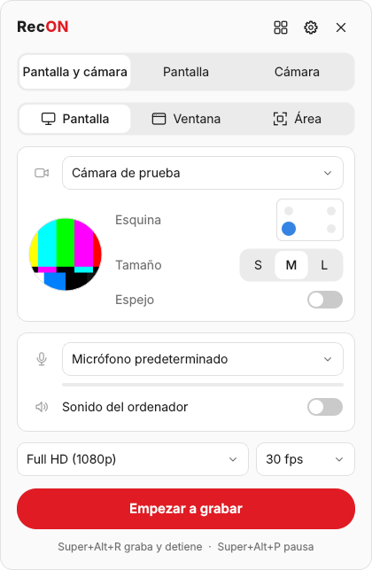
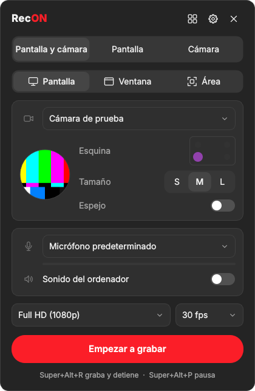
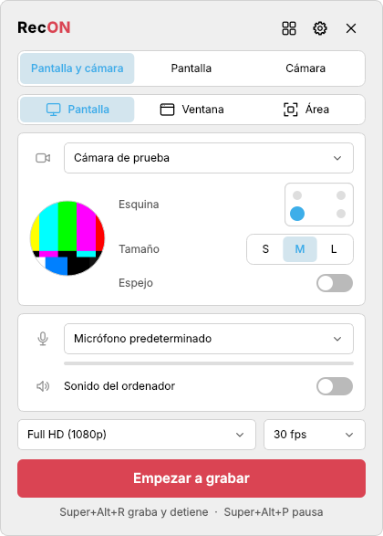
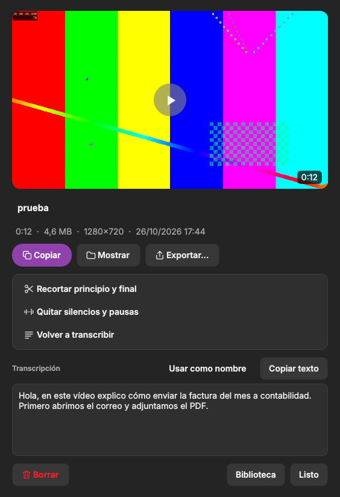
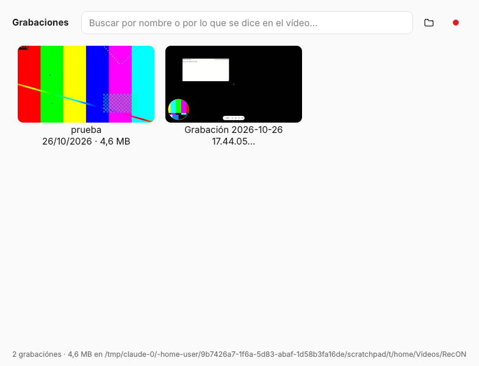

# RecON

Grabador de pantalla y webcam para Linux, pensado para la productividad. Es como Loom, pero se maneja con atajos al estilo de la Xbox Game Bar y todo el trabajo posterior se hace en tu equipo, sin internet.

<p align="center">
  
  
  
</p>

El diseño es minimalista y se adapta al escritorio: modo claro u oscuro, color de acento, tipo de letra y forma de los botones. En GNOME y Zorin los botones son planos y redondeados, como en libadwaita; en KDE Plasma son compactos y con borde, como en Breeze; Cinnamon, XFCE y MATE tienen un término medio.

## Qué hace

**Grabar**
- La pantalla completa, una ventana o un área que marcas con el ratón.
- La cámara en una burbuja redonda, en la esquina y del tamaño que elijas. También puedes grabar solo la cámara.
- El micrófono (con un medidor para ver que te oye) y, si quieres, el sonido del ordenador.
- Una cuenta atrás que no sale en el vídeo y una barra flotante con el tiempo, pausa, detener, silenciar el micro y descartar.
- Funciona en X11 y en Wayland. En Wayland el escritorio te pregunta la primera vez qué pantalla compartir y RecON recuerda el permiso.

**Atajos (como en la Xbox Game Bar)**

| Atajo | Qué hace |
|---|---|
| `Super+Alt+R` | Empezar a grabar con lo último que elegiste, o detener y guardar |
| `Super+Alt+P` | Pausar o seguir |
| `Super+Alt+M` | Silenciar o activar el micrófono |
| `Super+Alt+G` | Guardar los últimos segundos (repetición instantánea) |
| `Super+Alt+O` | Abrir el panel |

Se configuran solos en GNOME, KDE Plasma, Cinnamon y XFCE, y se pueden cambiar en **Ajustes**. En Hyprland, Sway y niri, RecON te dice qué líneas añadir a tu configuración.

**Después de grabar, en un clic y sin internet**

<p align="center"></p>

- **Copiar** el vídeo para pegarlo en WhatsApp, Telegram, Slack, un correo o una carpeta, o arrastrar la miniatura.
- **Renombrar**. Si lo transcribes, RecON propone la primera frase como nombre.
- **Recortar** el principio y el final, viendo el fotograma de cada punto. Es instantáneo porque no vuelve a codificar el vídeo.
- **Quitar silencios y pausas** largas de forma automática.
- **Reducir el ruido** del micrófono (zumbidos, ventiladores) al guardar.
- **Exportar** para WhatsApp (menos de 16 MB), correo (menos de 25 MB), MP4 ligero de 720p, GIF, solo audio o con subtítulos en la imagen. El archivo exportado queda copiado, listo para pegar.
- **Transcribir y crear subtítulos** (.srt) con Whisper en tu equipo. Es opcional: se instala una vez desde Ajustes.

**Más cosas**
- **Repetición instantánea**: con ella activada, `Super+Alt+G` guarda los últimos 15, 30, 60 o 120 segundos aunque no estuvieras grabando.
- **Biblioteca** con miniaturas y búsqueda por nombre y por lo que se dice en el vídeo. Por ejemplo, escribe «factura» y encuentra el vídeo donde lo explicaste.
- **A prueba de cortes**: la grabación se guarda por trozos mientras grabas. Si el equipo se apaga a mitad, RecON la recupera al volver a arrancar.
- Si la cámara la está usando otra aplicación o el micrófono falla, RecON sigue grabando sin ellos y te avisa.

<p align="center"></p>

## Instalación (Debian, Ubuntu, Linux Mint, Pop!_OS, Zorin OS)

```sh
wget https://github.com/anrennnn/RecON/raw/main/instalador/recon_0.1.0_all.deb
sudo apt install ./recon_0.1.0_all.deb
```

Usa `./` delante del nombre del archivo: si no, apt lo busca en los repositorios y da «fichero no admitido».

Después ábrelo desde el menú de aplicaciones o pulsa `Super+Alt+O`. RecON queda en segundo plano (y se inicia con la sesión) para que los atajos respondan al instante.

Está probado instalando el paquete en Ubuntu 24.04 limpio (PyQt6) y en Ubuntu 22.04 limpio (PyQt5, la base de Zorin OS 17, Linux Mint 21 y Pop!_OS 22.04).

### Primeros pasos según el escritorio

- **GNOME / Zorin / Ubuntu con Wayland**: la primera grabación abre la ventana del sistema para elegir la pantalla. RecON guarda ese permiso y, donde el escritorio lo admite, no vuelve a preguntar (en KDE, marca la casilla para recordar la elección).
- **KDE Plasma**: los atajos se aplican al momento. Si KDE no responde, RecON los deja escritos y funcionan tras cerrar sesión y volver a entrar.
- **XFCE o MATE sin compositor**: funciona igual. El área se marca sobre una captura de la pantalla.

### Transcripción (opcional)

En **Ajustes → Transcripción** pulsa **Instalar**. Se descarga [faster-whisper](https://github.com/SYSTRAN/faster-whisper) en `~/.local/share/recon/transcripcion` (unos 300 MB, necesita internet esa vez). El modelo se descarga en la primera transcripción: «Rápido» ocupa 75 MB y «Preciso» 480 MB. A partir de ahí funciona sin conexión. Necesita el paquete `python3-venv`.

## Dónde se guarda todo

- Vídeos: `~/Vídeos/RecON` (o la carpeta que elijas en Ajustes). Los subtítulos y la transcripción quedan al lado (`.srt` y `.txt`).
- Ajustes: `~/.config/recon/ajustes.json`.
- Grabación en curso (trozos): `~/.local/share/recon/en-curso`.

## Comandos

```
recon               abre el panel
recon grabar        empieza a grabar o detiene y guarda
recon pausa         pausa o sigue
recon micro         silencia o activa el micrófono
recon repeticion    guarda los últimos segundos
recon biblioteca    abre la biblioteca
recon ajustes       abre los ajustes
recon atajos        vuelve a poner los atajos en el escritorio
recon salir         cierra el proceso de fondo
```

## Desinstalar

```sh
recon atajos --quitar
sudo apt remove recon
```

## Construir el paquete

```sh
./build-deb.sh    # deja dist/recon_<versión>_all.deb
```

## Cómo funciona

- Interfaz en Python con PyQt6, o PyQt5 donde no hay PyQt6.
- Grabación con GStreamer. En X11 la pantalla se lee con `ximagesrc`; en Wayland, con el portal `org.freedesktop.portal.ScreenCast` y PipeWire. La burbuja de la cámara se pinta dentro del vídeo, así que sale igual en cualquier escritorio y también al grabar una sola ventana.
- Vídeo H.264 con un fotograma clave por segundo, para que recortar sin volver a codificar sea preciso. El audio es Opus durante la grabación y AAC en el MP4 final.
- Cada tramo entre pausas es un `.mkv` que se puede leer aunque se corte de golpe. Al terminar, FFmpeg une los tramos sin volver a codificar el vídeo.
- Recortar, quitar silencios, reducir el ruido y exportar se hacen con FFmpeg.

## Licencia

MIT. Ver [LICENSE](LICENSE).
